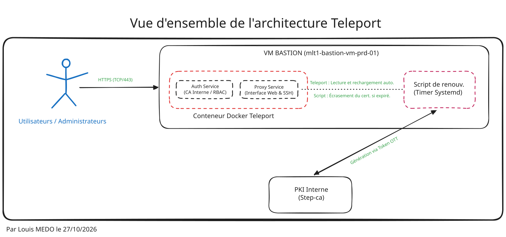
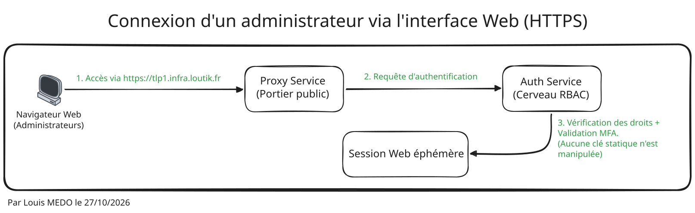
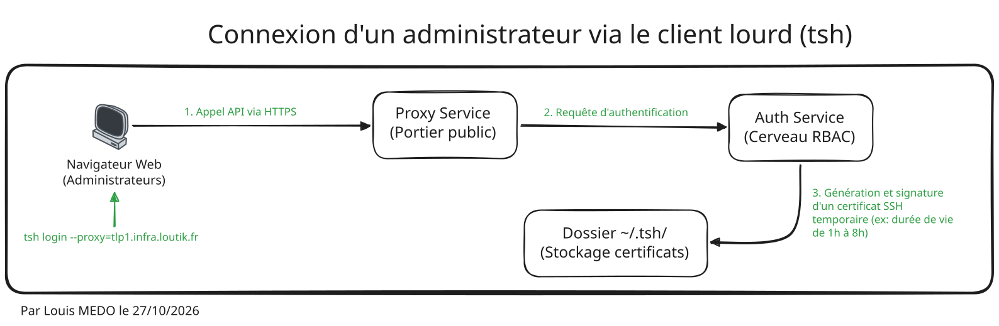

## A. Contexte

Dans le cadre de l'évolution de mon homelab LoutikCLOUD, j'ai déployé Teleport sur une machine virtuelle jouant le rôle de bastion (nœud `tlp1.infra.loutik.fr`). L'objectif était de centraliser et de sécuriser l'accès à l'ensemble de mes ressources internes (serveurs Proxmox, clusters Kubernetes K3s, bases de données) en remplaçant la gestion artisanale des clés SSH par un système d'authentification robuste basé sur des certificats éphémères. 

:::note
Cette approche "Zero Trust"[^1] permet non seulement de s'affranchir d'un VPN traditionnel, mais offre également un audit complet (enregistrement des sessions) indispensable pour une infrastructure DevSecOps moderne.
:::

## B. Architecture

L'architecture s'appuie sur une approche conteneurisée. Le service Teleport tourne via Docker sur la VM bastion. L'interface Web (Proxy Service) et le moteur de gestion des droits (Auth Service) y sont hébergés. Une particularité de cette topologie est son couplage fort avec ma PKI interne (`step-ca`) pour la délivrance des certificats de l'interface publique.

### B.1. Vue d'ensemble de l'architecture Teleport

*Schéma - Vue d'ensemble de l'architecture du bastion Teleport*

### B.2. Connexion d'un administrateur via l'interface Web (HTTPS)

*Schéma - Connexion d'un administrateur via l'interface Web (HTTPS) du bastion Teleport*

### B.3. Connexion d'un administrateur via le client lourd (tsh)

*Schéma - Connexion d'un administrateur via le client lourd (tsh) du bastion Teleport*

## C. Déploiement

Le déploiement s'est fait en deux grandes étapes : une phase d'exploration manuelle pour valider la faisabilité technique, suivie d'une phase d'industrialisation indispensable pour pérenniser l'infrastructure LoutikCLOUD.

### C.1. Phase d'exploration et configuration manuelle

Pour garantir une isolation maximale, j'ai d'abord créé un utilisateur et un groupe système dédiés sans accès au shell, qui sont propriétaires de l'arborescence `/opt/teleport`. Le conteneur s'appuie sur l'image AWS ECR durcie[^2] de Teleport (version distroless) pour réduire la surface d'attaque.

Le choix d'exposer le service Proxy sur le port standard 443 (HTTPS) n'est pas anodin. Techniquement, cela nécessite d'autoriser le conteneur à ouvrir un port privilégié via la directive `sysctls: net.ipv4.ip_unprivileged_port_start=443`. Stratégiquement, cela simplifie grandement la gestion des flux dans mon pare-feu OPNsense : je peux réutiliser mon alias[^7] existant qui regroupe déjà les ports web (80 et 443) au lieu de devoir créer une énième règle de filtrage spécifique à Teleport. Enfin, c'est beaucoup plus ergonomique et naturel à taper dans la barre d'adresse du navigateur. D'autant que le port spécéfique de Teleport n'apporte pas une réel plus value en terme de sécurité comme un scan nmap permet de découvrir rapidement le port ouvert.

La finalisation de cette première phase s'est déroulée via la ligne de commande pour initialiser le compte administrateur. J'ai ensuite basculé sur l'interface Web pour accepter les conditions d'utilisation, configurer un mot de passe robuste généré par mon gestionnaire via le lien d'invitation temporaire, et imposer obligatoirement un second facteur d'authentification (MFA) via l'application OTP[^3] Proton Authenticator.

### C.2. Industrialisation via l'Infrastructure as Code (IaC)

Une fois le concept technique validé, l'installation manuelle a été intégralement traduite en code via Ansible (playbook `tlp-bootstrap.yml`). Cette étape est au cœur de la philosophie DevSecOps.

J'ai structuré la configuration en séparant le code de la donnée : les variables spécifiques (FQDN, identifiants systèmes, arborescence des rôles RBAC par environnement) sont centralisées dans un dictionnaire `bastion.yml`. Les fichiers de configuration complexes, tels que `teleport.yaml` et `docker-compose.yml`, sont générés dynamiquement au moment du déploiement grâce à des templates Jinja2 (`.j2`). Les tâches Ansible se chargent du travail répétitif : création des comptes, application stricte des droits sur les dossiers, et démarrage du conteneur.

Cette approche par l'IaC[^4] m'offre une immense résilience dans mon homelab. Je peux désormais détruire toute l'infrastructure pour changer de contexte de travail, et remonter les services à l'identique en quelques minutes. En cas de corruption ou de dysfonctionnement majeur, je suis en capacité de provisionner une nouvelle machine virtuelle bastion pleinement fonctionnelle sans aucune intervention manuelle fastidieuse.

## D. Difficultés

Lors de la mise en place, deux problématiques techniques majeures ont dû être résolues :

* **Erreur de validation de la chaîne de confiance :** L'image Docker de Teleport refusait de démarrer car elle ne connaissait pas mon autorité de certification (CA) interne. *Solution :* J'ai modifié le Docker Compose pour monter le certificat `root_ca_loutik.crt` directement dans le dossier `/etc/ssl/certs/` du conteneur en lecture seule (`:ro`) et l'ai déclaré via la variable d'environnement `SSL_CERT_FILE`.

* **Automatisation des certificats de l'interface Web (sans ACME[^5] externe) :** Teleport gère très bien ses certificats internes pour SSH, mais ne dispose pas de client ACME natif pour discuter avec ma PKI privée `step-ca`. L'ajout manuel d'exceptions de sécurité n'était pas viable. *Solution :* J'ai généré un jeton à usage unique (OTT)[^6] côté PKI, consommé par le client `step-cli` sur le bastion pour générer le certificat initial. Pour le renouvellement, j'ai créé un script Bash `teleport-cert-renew.sh` (couplé à un Systemd Timer quotidien) qui vérifie si le certificat expire dans moins de 360 heures (15 jours). Si c'est le cas, le script force le renouvellement et place le nouveau certificat dans le dossier `/opt/teleport/data` pour que Teleport puisse le lire (il vérifie toutes les 15 minutes s'il y n'y a pas un nouveau certificat : `https_keypairs_reload_interval: 15m`).

---

[^1]: **Zero Trust :** Modèle de sécurité informatique qui part du principe qu'aucun utilisateur ou appareil n'est digne de confiance par défaut, même s'il est déjà connecté au réseau interne de l'entreprise.
[^2]: **Image Durcie (Distroless) :** Version allégée d'un système d'exploitation pour conteneur qui ne contient strictement que l'application et ses dépendances. Elle n'inclut pas de shell ou d'outils de base, réduisant ainsi drastiquement les failles de sécurité exploitables.
[^3]: **OTP (One-Time Password) :** Mot de passe à usage unique, souvent sous forme d'un code à 6 chiffres généré par le smartphone, changeant toutes les 30 secondes pour valider une connexion (MFA).
[^4]: **IaC (Infrastructure as Code) :** Pratique consistant à écrire des lignes de code (ici via Ansible) pour déployer et configurer des serveurs, au lieu de cliquer dans des menus ou de taper des commandes manuellement.
[^5]: **ACME (Automated Certificate Management Environment) :** Protocole de communication standard qui permet aux serveurs de demander et de renouveler automatiquement leurs certificats de sécurité HTTPS (utilisé par exemple par Let's Encrypt).
[^6]: **OTT (One-Time Token) :** Jeton d'autorisation temporaire et à usage unique. Il sert de "mot de passe jetable" pour permettre à une machine de prouver son identité à l'autorité de certification le temps de récupérer son certificat officiel.
[^7]: **Alias (Pare-feu) :** Groupe logique utilisé dans un pare-feu (comme OPNsense) pour rassembler plusieurs adresses IP ou ports sous un même nom, ce qui simplifie grandement l'écriture et la lecture des règles de sécurité.
