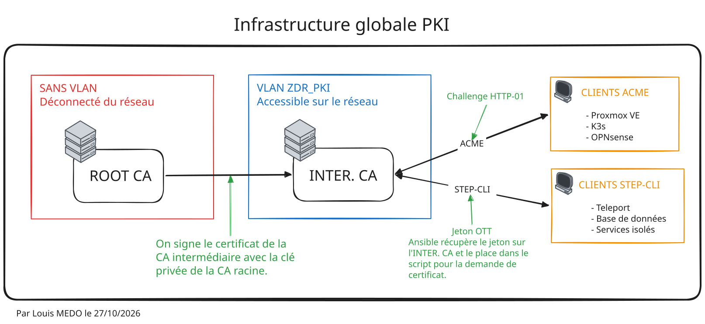
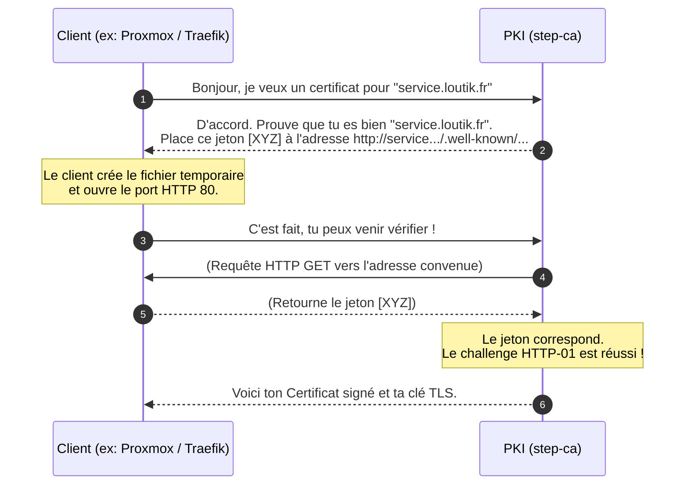
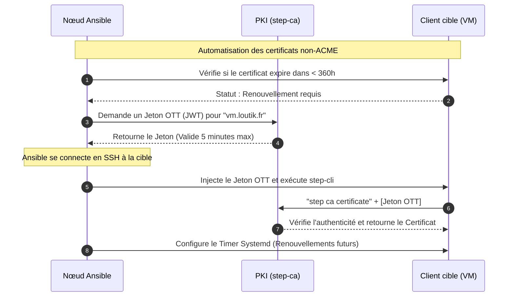

import { Steps } from '@astrojs/starlight/components';

## A. Contexte

La mise en place d'une autorité de certification (PKI[^1]) interne est une étape charnière pour sécuriser les flux au sein de l'infrastructure. Dans l'infrastructure LoutikCLOUD, l'objectif était de remplacer les certificats auto-signés éparpillés par une gestion centralisée, automatisée et sécurisée. La solution **step-ca** a été retenue pour sa légèreté et sa prise en charge native d'ACME[^2].

Le service a été déployé de manière structurée : une autorité racine gardée hors-ligne (pour protéger la clé maîtresse) et une autorité intermédiaire en ligne (sur une VM Debian dédiée dans un vlan situé dans la zone de diffusion restreinte) qui distribue les certificats. L'ensemble de la configuration a été pensé pour s'intégrer de manière idempotente[^3] dans nos playbooks Ansible, tout en respectant le principe de moindre privilège.

## B. Architecture

L'architecture repose sur une séparation stricte des rôles et propose deux méthodes de distribution des certificats selon les capacités des clients (via ACME ou via des jetons OTT[^4]).

### B.1. Architecture globale de la PKI

### B.2. Le challenge ACME HTTP-01

### B.3. Le workflow step-cli avec Ansible (Jeton OTT)

:::note
La vérification des certificats racines téléchargés sur les clients est assurée par un contrôle d'intégrité (hash SHA256) avant toute importation, évitant ainsi les risques d'attaques MITM[^5] lors du provisionnement.
:::

## C. Déploiement

La méthodologie de déploiement a été pensée "Infrastructure as Code" avec Ansible, tout en gardant une maîtrise absolue des processus cryptographiques.

<Steps>

1. **Création de l'environnement sécurisé (Moindre privilège) :** Le service `step-ca` manipulant des clés privées, il était hors de question de le faire tourner en `root`. Un utilisateur système dédié `step` (sans shell interactif `bin/false`) a été créé. Les clés et configurations (`/etc/step-ca`) lui appartiennent exclusivement avec des permissions strictes (`600`).

2. **Initialisation Headless[^6] de la Racine et de l'Intermédiaire :** Au lieu d'utiliser l'assistant interactif de `step`, la PKI a été initialisée manuellement en injectant les mots de passe via des fichiers texte sécurisés (`--password-file`). Le certificat racine (`root_ca.crt`) a été généré, puis a servi à signer le certificat intermédiaire (`intermediate_ca.crt`).

3. **Configuration des Provisioners (ACME) :** Un provisioner de type ACME a été ajouté à la configuration avec des durées de validité (X.509) calibrées sur 720 heures (30 jours), forçant ainsi un renouvellement fréquent et réduisant la surface d'attaque.

4. **Déploiement automatisé du certificat racine :** Pour que les machines fassent confiance à la PKI, une tâche Ansible (`get_url`) télécharge le fichier `roots.pem` depuis la PKI. La tâche vérifie rigoureusement le `checksum` SHA256 avant de copier le fichier dans `/usr/local/share/ca-certificates/` et d'exécuter `update-ca-certificates`.

5. **Automatisation via Jeton (Pour les clients non-ACME) :** Un rôle Ansible dédié (`step-get-cert`) a été développé. Plutôt que de transférer des clés privées par SSH, Ansible délègue une commande sur le serveur PKI pour générer un jeton JWT unique. Ce jeton est ensuite utilisé par le client cible pour générer lui-même sa clé privée et récupérer son certificat. Un script bash couplé à un *Timer Systemd* est ensuite déployé sur le client pour s'occuper du renouvellement de manière autonome.
</Steps>

## D. Difficultés

Lors de la mise en place, quelques ajustements ont été nécessaires pour concilier sécurité absolue et exigences techniques :

* **Le renouvellement des certificats hors écosystème ACME :** Si Proxmox ou Traefik gèrent l'ACME nativement, de simples machines virtuelles Debian hébergeant des petits services n'ont pas de client intégré.
*Solution apportée :* Le développement du rôle Ansible personnalisé qui utilise la fonctionnalité "OTT" (One-Time Token) de step-ca. Le vrai défi fut l'idempotence : j'ai dû rajouter une commande `step certificate needs-renewal` dans Ansible. Ainsi, le playbook vérifie si le certificat a moins de 360 heures à vivre ; si ce n'est pas le cas, il saute l'étape de génération de jeton, évitant de surcharger la PKI inutilement à chaque passage d'Ansible.

---

[^1]: **PKI (Public Key Infrastructure) :** Architecture globale de confiance (logiciels, procédures, clés) permettant d'émettre et de gérer le cycle de vie de certificats de sécurité numériques.
[^2]: **ACME (Automatic Certificate Management Environment) :** Protocole standardisé permettant l'automatisation complète de la validation de domaine, de l'émission et du renouvellement des certificats TLS (utilisé mondialement par Let's Encrypt).
[^3]: **Idempotente (Idempotence) :** En automatisation (comme avec Ansible), c'est la propriété d'un script qui garantit que l'exécuter une fois ou dix fois de suite donnera exactement le même état final, sans tout casser ni recréer inutilement.
[^4]: **OTT (One-Time Token) / JWT :** Jeton de sécurité à usage unique (souvent au format JSON Web Token). Il agit comme un ticket d'entrée temporaire prouvant au serveur PKI que la machine est autorisée à demander un certificat.
[^5]: **MITM (Man In The Middle) :** Attaque où un pirate s'intercale discrètement entre deux machines pour écouter ou altérer les communications. Valider l'empreinte d'un certificat racine empêche un attaquant de fournir un "faux" certificat racine.
[^6]: **Headless :** Se dit d'un déploiement ou d'une application qui fonctionne sans interface graphique utilisateur ni invite de commande interactive. L'outil s'exécute silencieusement en arrière-plan via des fichiers de configuration pré-remplis.
